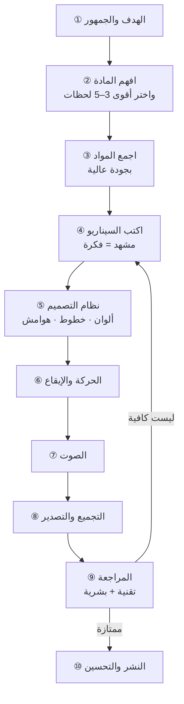

# دليل الطالب: كيف تصنع فيديو قصيرًا ممتازًا من أي مادة

> **لمن؟** لكل طالب يريد أن يشرح موضوعًا أو يعرّف بمشروع أو موقع أو تطبيق أو محاضرة في **فيديو قصير** (15–90 ثانية).
> **ما الذي ستخرج به؟** عشر خطوات أساسية، وقوالب جاهزة، وقائمة فحص، ومقياس تقييم تعرف به **هل وصلت لأفضل نتيجة؟**
> **لا يعتمد على أداة بعينها:** الخطوات نفسها تنفع مع أي برنامج مونتاج أو تصوير أو برمجة.

---

## 1) الفكرة في صفحة واحدة

الفيديو الجيد ليس «جميلًا» فقط، بل **يوصل فكرة واحدة بوضوح خلال ثوانٍ، ويُفهَم حتى دون صوت.**



```
 فكرة واحدة  ──►  لحظات قوية  ──►  مواد نظيفة  ──►  سيناريو قصير
     │                                                    │
     └──────────── تصميم ثابت + حركة هادئة ◄──────────────┘
                              │
                     صوت مضبوط + تصدير صحيح
                              │
                    مراجعة صارمة  ──►  نشر  ──►  تحسين
```

**القاعدة الذهبية الثلاث:**
1. **فكرة واحدة** للفيديو، وفكرة واحدة للمشهد.
2. **أرِ ولا تقل** (Show, don't tell): لقطة حقيقية تحرّك الفكرة أقوى من جملة تشرحها.
3. **اختبر بعينك** قبل أن تعتمد: ما لا تراه بنفسك لا تضمنه.

---

## 2) الخطوة ① — الهدف والجمهور

### املأ «ورقة الفكرة» أولًا (5 دقائق)
| السؤال | مثال لإجابة جيدة | إجابة ضعيفة |
|---|---|---|
| ماذا أريد من المشاهد أن **يفعل** بعد الفيديو؟ | يجرّب الأداة بنفسه | «يعرف عنها» |
| من هو المشاهد؟ | طالب سنة أولى يتصفح من جواله | «الجميع» |
| ما الجملة الواحدة التي أريده أن يتذكرها؟ | «تفهم الفكرة بتجربتها بنفسك» | «شرح الموضوع» |
| أين سيُعرض؟ | هاتف، عمودي، غالبًا بلا صوت | «في أي مكان» |
| كم المدة؟ | 45–60 ثانية | «حتى ننتهي» |
| ما الذي يجب **ألا** يظهر؟ | روابط/شعارات غير مصرّح بها | — |

**قاعدة:** إن لم تستطع كتابة هدفك في جملة واحدة فالفيديو سيبدو مشوّشًا.

---

## 3) الخطوة ② — افهم المادة واختر أقوى اللحظات

لا تضع كل شيء في الفيديو. **اختر ما يُرى ويُفهم بسرعة.**

### جدول الجرد
| العنصر | هل يتحرك أو يتغيّر على الشاشة؟ | هل يُفهم دون صوت؟ | هل الفرق واضح (قبل/بعد)؟ | الدرجة /3 |
|---|---|---|---|---|
| مثال: أداة تفاعلية | ✅ | ✅ | ✅ | 3 |
| مثال: فقرة شرح | ❌ | ❌ | ❌ | 0 |

**اختر 3–5 عناصر بأعلى درجة.** ثم ابحث عن:
- **لحظة «قبل/بعد»:** المفهوم كنص جامد ← نفس المفهوم حيًّا. هذا أقوى مشهد تقنع به.
- **لحظة «افعلها بنفسك»:** تحريك شيء ورؤية نتيجته فورًا.
- **لحظة «الصورة الكبيرة»:** كل ما تقدمه في نظرة واحدة (جولة سريعة).

**اسأل نفسك:** لو أُغلق الصوت، هل يفهم المشاهد الفكرة من الصورة وحدها؟

---

## 4) الخطوة ③ — اجمع المواد بجودة عالية

| المبدأ | لماذا؟ | كيف؟ |
|---|---|---|
| **سجّل الشيء الحقيقي** | يبني الثقة أكثر من الرسوم المزيّفة | تسجيل شاشة/كاميرا لما يعمل فعلًا |
| **بسرعة طبيعية** | التسريع يُفقد الفهم | لا تسرّع التفاعل؛ اختصر بالقص لا بالتسريع |
| **بدقة أعلى من المطلوب** | تتيح التكبير دون تشويش | سجّل بدقة أكبر من حجم العرض النهائي |
| **أظهر الأداة كاملة** | الاقتطاع يضيّع السياق | ضبط حجم الشاشة على حجم الأداة، لا العكس |
| **أظهر كيف تُستخدم** | المشاهد يتعلم من الحركة | مؤشر ماوس/إصبع مرئي يتحرك ويضغط |
| **نظّف الإطار** | تشتيت = ضياع | أخفِ الأشرطة والإشعارات وما لا علاقة له |
| **ثبّت الظروف** | تناسق بين اللقطات | نفس السمة (فاتح/داكن)، نفس اللغة، نفس الحجم |
| **اجمع الحقوق** | حماية لك | سجّل مصدر كل صورة وخط وموسيقى ورخصتها |

**مجلد منظّم:** `خام/` للمواد الأصلية · `مشروع/` للعمل · `تصدير/` للنتيجة. **لا تعدّل على الأصل أبدًا** — اعمل على نسخة.

---

## 5) الخطوة ④ — اكتب السيناريو (قبل أي مونتاج)

### بنية آمنة لفيديو 45–60 ثانية
| الجزء | المدة التقريبية | وظيفته |
|---|---|---|
| **الافتتاح** | 3–5 ث | اسم الموضوع + سبب الاهتمام |
| **نظرة عامة** | 4–6 ث | ماذا يوجد هنا؟ |
| **قبل ← بعد** | 6–10 ث | الصدمة الإيجابية: الفرق بالصورة |
| **أمثلة تفاعلية** | 25–35 ث | كل مثال 3–7 ثوانٍ، فكرة لكل مثال |
| **الدعوة** | 3–5 ث | ماذا يفعل المشاهد الآن؟ |

### جدول السيناريو (انسخه)
| # | الزمن | اللقطة | النص الظاهر (≤7 كلمات) | الحركة | الانتقال |
|---|---|---|---|---|---|
| 1 | 0–5 | | | | |
| 2 | | | | | |

### قواعد الكتابة
1. **≤ 7 كلمات** للنص الواحد، وسطران كحد أقصى.
2. **أفعال أمر قصيرة:** «اضغط… وشاهد الفرق».
3. **كلمة مفتاحية واحدة** مميّزة بلون في كل عنوان.
4. **وسم صغير** يوضح اسم الجزء الحالي.
5. **لا تكرّر** ما تقوله الصورة.
6. مدة المشهد = **زمن الحدث** + ثانية للاستيعاب. لا تُطِل على شاشة ثابتة.

**اختبار:** اقرأ السيناريو **دون مشاهدة**. إن فهمت الفكرة فالفيديو سيعمل.

---

## 6) الخطوة ⑤ — نظام التصميم (قرّر مرة وطبّق دائمًا)

> نظام التصميم = **قرارات مكتوبة** تمنع العشوائية. اكتبها قبل أول مشهد.

### قالب جاهز (املأه)
| العنصر | قرارك |
|---|---|
| **الخلفية** | لون واحد غامق أو فاتح |
| **لون التمييز** | **واحد فقط**، للكلمة المفتاحية والأزرار |
| **النص** | أبيض/أسود مع درجة أخف للثانوي |
| **الخط الأساسي** | واحد للعناوين، وواحد للنص (أو عائلة واحدة) |
| **أحجام النص** | عنوان ≥ 80px · ثانوي ≥ 48px على لوحة 1080×1920 |
| **الهوامش الآمنة** | أعلى 250 · أسفل 400 · جانبان 120 (قيم مقترحة؛ راجع المنصة) |
| **الحركة** | منحنى واحد، ومدة دخول ثابتة (0.4–0.8 ث) |
| **الانتقال** | نوع واحد أساسي (مزج) وآخر للحدث المهم (مسح) |

### قواعد تصميم لا تُكسر
1. **لون تمييز واحد.** كثرة الألوان تقتل الأولوية.
2. **تباين قوي:** النص الصغير على خلفية بتباين لا يقل عن 4.5:1 (الأفضل أعلى بكثير).
3. **حجم يُقرأ من الجوال:** ما لا تقرؤه وأنت تبتعد بالشاشة لا يقرؤه المشاهد.
4. **هرمية واضحة:** عنوان كبير ← فرعي ← تفصيل؛ لا تجعل كل شيء بنفس الحجم.
5. **مساحة فارغة** ليست هدرًا؛ هي ما يجعل العنصر المهم يبرز.
6. **لا تصغّر اللقطة** حتى تضيع تفاصيلها؛ كبّر الجزء المهم وحرّكه ببطء.
7. **اتساق:** نفس الوسم ونفس الدخول ونفس المسافات في كل المشاهد.

### الخطوط والعربية خصوصًا
- **اتجاه الكتابة:** اضبط RTL على عناصر النص نفسها.
- **ضمّن الخط في المشروع** بدل الاعتماد على خطوط الجهاز (وإلا ستظهر خطوط بديلة على جهاز آخر).
- **حروف لاتينية وأرقام:** تأكد أن الخط يدعمها، وإلا أضف خطًّا احتياطيًا من العائلة نفسها.
- **قِس عرض العناوين:** بعض الخطوط العربية تمدّ الحروف فيتغير العرض كثيرًا بين عبارة وأخرى.
- **اختبر التشكيل والأرقام** (١٢٣ و123) والكلمات الطويلة قبل اعتماد الحجم.

---

## 7) الخطوة ⑥ — الحركة والإيقاع

| المبدأ | التطبيق |
|---|---|
| **الحركة تخدم الفهم** | تحرّك العنصر لتوجّه النظر لا لتزيّن |
| **دخول ناعم** | تلاشٍ + إزاحة قصيرة + (اختياري) تمويه خفيف يزول |
| **تسارع طبيعي** | ابدأ سريعًا واستقر ببطء (ease-out) |
| **انتقال متداخل** | المشهد الجديد يبدأ قبل نهاية السابق بـ0.2–0.4 ث |
| **حدث واحد في المرة** | لا تحرّك ثلاثة أشياء معًا |
| **قبل/بعد بمسح** | المسح يُبرز الفرق أكثر من القطع |
| **أرِ التفاعل** | مؤشر يسحب ويضغط، وحلقة عند النقر |
| **اهدأ** | الإفراط في الحركة يتعب العين ويشتّت |

### الإيقاع مع الموسيقى
1. اعرف **BPM** المقطوعة وموضع **أول ضربة**.
2. اجعل **حدود المشاهد الكبرى** على الضربات (هامش ±0.3 ث يكفي).
3. المشهد القصير (2–3 ث) يقابل ~4 ضربات؛ الطويل (6–7 ث) ~10 ضربات.
4. لا تضحِّ بوضوح التفاعل من أجل ضربة؛ **الفهم أولًا**.

---

## 8) الخطوة ⑦ — الصوت

| المبدأ | التطبيق |
|---|---|
| **الموسيقى تخدم ولا تغطي** | هادئة، بلا غناء إن كان هناك كلام أو نص كثير |
| **حقوق الاستخدام** | موسيقى مرخّصة أو مفتوحة الرخصة؛ احفظ الرخصة |
| **طول مناسب** | قصّها لمدة الفيديو **بنهاية طبيعية** + تلاشٍ في آخر ثانية ونصف |
| **الجهارة** | اجعل الفيديو النهائي قرب **‎−14 LUFS** وذروة لا تتجاوز ‎−1 إلى ‎−1.5 dB |
| **الكلام أولًا** | إن وُجد تعليق فاخفض الموسيقى تحته (ducking) |
| **اختبر بسماعة وبمكبّر الجوال** | الاختلاف كبير |
| **جهّز نسخة بلا صوت** | معظم المشاهدين يتصفحون دون صوت |

---

## 9) الخطوة ⑧ — التجميع والتصدير

### إعدادات مقترحة لفيديو عمودي
| المعامل | القيمة |
|---|---|
| الأبعاد | 1080 × 1920 (9:16) |
| معدل الإطارات | 30 fps |
| الترميز | H.264 (MP4) · صيغة بكسل yuv420p |
| الجودة | CRF 18 تقريبًا (أصغر = أجود) |
| الصوت | AAC · 48 kHz · ستيريو · 192 kbps |
| البدء السريع | فعّل `faststart` للتشغيل أثناء التحميل |
| الاسم | `اسم_المشروع_رقم-النسخة.mp4` (v1, v2…) |

**الصورة المصغّرة (الغلاف):** عنوان كبير بخط الهوية، وكلمة مفتاحية بلون التمييز، داخل المنطقة الآمنة ومتمركز (لأن المنصات تقصّ الأطراف).

**قاعدة:** صدّر نسخة تجريبية مبكرًا لا في اليوم الأخير.

---

## 10) الخطوة ⑨ — المراجعة (التقنية + البشرية)

### أ) فحص تقني
- [ ] المدة والأبعاد وfps كما خططت
- [ ] جهارة الصوت وذروته ضمن الهدف
- [ ] لا نص أو عنصر مهم داخل الهوامش
- [ ] لا خط بديل في أي مشهد (قارن بلقطة المرجع)
- [ ] لا لقطة مقصوصة أو محتوى متسرّب من خارج الإطار
- [ ] لا أخطاء إملائية (اقرأ كل نص بصوت عالٍ)
- [ ] الألوان والخطوط متسقة بين كل المشاهد

### ب) فحص بشري (لا يُستغنى عنه)
| الاختبار | كيف؟ | النجاح |
|---|---|---|
| **اختبار الثواني الخمس** | اعرضه 5 ثوانٍ على شخص | يقول الموضوع تقريبًا |
| **اختبار الصمت** | شاهده بلا صوت | تُفهم الفكرة |
| **اختبار الجوال** | على جوال حقيقي بسطوع عادي | كل نص يُقرأ |
| **اختبار الغريب** | شخص لا يعرف المادة | يصف ما يفعله الموقع/الأداة |
| **اختبار الملل** | اسأل: أين شعرت بالملل؟ | لا مشهد ممل أو بطيء |

**قاعدة المراجع:** سجّل ملاحظات المشاهدين **كما قيلت**، ولا تدافع عنها، ثم عدّل.

---

## 11) الخطوة ⑩ — النشر والتحسين
1. **العنوان والوصف:** جملة الهدف + ما سيجده المشاهد + الدعوة.
2. **الرابط:** ضعه في الوصف إن لم يظهر في الفيديو.
3. **الوسوم:** قليلة ومتعلقة بالموضوع.
4. **الإفصاح:** إن كان المشروع غير رسمي أو طلابيًا فاذكر ذلك.
5. **توقيت النشر:** حين يكون جمهورك متصلًا.
6. **القياس:** نسبة مشاهدة الثواني الأولى، ونقطة التوقف عن المشاهدة، والتفاعل.
7. **التحسين:** غيّر **شيئًا واحدًا** في كل نسخة (الافتتاح، الغلاف، الإيقاع) لتعرف ما الذي نفع.
8. **نسخ احتياطي:** احفظ المشروع والمصادر وملف التصدير في مكانين.

---

## 12) أخطاء شائعة وكيف تتجنبها
| الخطأ | لماذا يضر؟ | الحل |
|---|---|---|
| فيديو بلا هدف واضح | مشتّت | ورقة الفكرة |
| وضع كل شيء | لا يتذكر المشاهد شيئًا | اختر 3–5 لحظات |
| نص كثير وصغير | لا يُقرأ على الجوال | ≤7 كلمات، ≥48px |
| خلفية مزدحمة | يضيع النص | خلفية هادئة ولون تمييز واحد |
| خط لا يدعم العربية/اللاتينية | يظهر خط بديل | ضمّن الخط واختبر الأحرف |
| تسريع التفاعل | لا يُفهم | قصّ بدل التسريع |
| لقطة مصغّرة جدًا | تفاصيل ضائعة | كبّر الجزء المهم |
| موسيقى صاخبة | تغطي الفكرة | هادئة وبمستوى أقل |
| صوت أعلى/أخفض من المعتاد | يُنفّر المشاهد | معايرة ‎−14 LUFS |
| عناصر مهمة في الأطراف | تُغطّى بواجهة المنصة | المنطقة الآمنة |
| اعتماد دون مراجعة | أخطاء تظهر بعد النشر | الخطوة ⑨ كاملة |
| استخدام مواد بلا إذن | مشاكل قانونية | سجّل الرخصة لكل مادة |

---

## 13) كيف تعرف أنك وصلت لأفضل نتيجة؟ (مقياس من 100)
| المعيار | الدرجة | أسئلة التقييم |
|---|---|---|
| **وضوح الفكرة** | /20 | هل تُفهم في 5 ثوانٍ؟ هل هناك فكرة واحدة؟ |
| **إظهار لا إخبار** | /15 | هل المادة الحقيقية تتحرك؟ هل يُفهم بلا صوت؟ |
| **القراءة على الجوال** | /15 | أحجام وتباين وهوامش |
| **اتساق التصميم** | /10 | ألوان وخطوط ومسافات موحّدة |
| **الإيقاع والحركة** | /15 | انتقالات ناعمة، لا ازدحام، تزامن مع الموسيقى |
| **الصوت** | /10 | مستوى مناسب، نهاية طبيعية، حقوق سليمة |
| **الدقة التقنية** | /10 | أبعاد، جهارة، لا أخطاء |
| **الدعوة** | /5 | هل يعرف المشاهد ماذا يفعل؟ |

**التفسير:** ≥ 90 ممتاز (انشر) · 75–89 جيد (عدّل نقطتين) · < 75 أعد السيناريو (الخطوة ④).

---

## 14) قوالب جاهزة للنسخ

### أ) ورقة الفكرة
```
الهدف (جملة): ……………………………………………
المشاهد: …………………  المنصة/الشاشة: …………………
الجملة التي يجب أن يتذكرها: ……………………………
المدة: ……  اللغة: ……  بصوت/بلا صوت: ……
ممنوع ظهوره: ……………………………………………
```

### ب) قائمة المواد
```
اللقطة | المصدر | الدقة | الرخصة | الحالة (جاهز/ناقص)
```

### ج) ملف قرارات التصميم (أسطر قليلة تكفي)
```
خلفية: #…… | تمييز: #…… | نص: #…… | ثانوي: #……
عنوان: [خط] … px | ثانوي: [خط] … px | وسم: … px
هوامش: أعلى … أسفل … جانب …
دخول: … ث · منحنى: …  | انتقال: …
```

### د) قائمة فحص النشر
```
☐ المدة ☐ الأبعاد ☐ الجهارة ☐ الهوامش ☐ الخطوط ☐ الإملاء
☐ الجوال ☐ بلا صوت ☐ الحقوق ☐ الغلاف ☐ الوصف ☐ نسخة احتياطية
```

---

## 15) تمارين تطبيقية
| # | التمرين | المهارة | معيار النجاح |
|---|---|---|---|
| 1 | اكتب «ورقة الفكرة» لفيديو عن موضوعك | الهدف | جملة واحدة واضحة |
| 2 | اجرد 10 عناصر وأعطِها درجات | الاختيار | اختيار 3–5 مبرّرة |
| 3 | اكتب سيناريو من 6 مشاهد بلا مشاهدة | الكتابة | يُفهم بالقراءة وحدها |
| 4 | صمّم «نظام تصميم» من 8 أسطر | الاتساق | غيّرت لون التمييز فتغيّر كل شيء |
| 5 | أخرج 15 ثانية فقط وراجعها بالاختبارات الخمسة | المراجعة | نجحت في 4 من 5 |
| 6 | اطلب من زميل تقييم فيديوك بالمقياس (100) | التقييم | ≥ 75 |
| 7 | غيّر **شيئًا واحدًا** في فيديوك وقارن | التحسين | عرفت ما الذي أثّر |

---

## 16) مصطلحات سريعة
| المصطلح | المعنى |
|---|---|
| **9:16** | نسبة الفيديو العمودي (الجوال) |
| **fps** | عدد الصور في الثانية |
| **LUFS** | قياس ارتفاع الصوت كما نسمعه |
| **الذروة (True Peak)** | أعلى قمة في الصوت |
| **BPM** | عدد ضربات الموسيقى في الدقيقة |
| **المنطقة الآمنة** | حيّز لا تضع فيه عنصرًا مهمًا لأن واجهة المنصة تغطيه |
| **RTL** | كتابة من اليمين لليسار |
| **CRF** | رقم جودة الضغط (أصغر = أجود) |
| **Hook** | افتتاح يجذب الانتباه |
| **CTA** | دعوة لفعل (جرّب، سجّل، تابع) |
| **Storyboard** | لوحة المشاهد قبل التنفيذ |
| **Easing** | منحنى تسارع الحركة |
| **Crossfade / Wipe** | انتقال بالمزج / بالمسح |

---

## 17) ملاحظة عن الأدوات
الأدوات تتغير والخطوات تبقى. اختر ما تتقنه:
- **تسجيل:** مسجّل شاشة أو كاميرا أو متصفح مؤتمت.
- **تجميع:** برنامج مونتاج أو إطار برمجي أو سكربتات.
- **صوت:** مكتبة موسيقى مرخّصة أو مفتوحة.
- **فحص:** ملف تعريف الوسائط (المدة/الأبعاد) وقياس الجهارة وفحص الهوامش.

الأهم: **اكتب قراراتك، اختبر كل مرحلة وحدها، وراجع بعين غيرك.**
